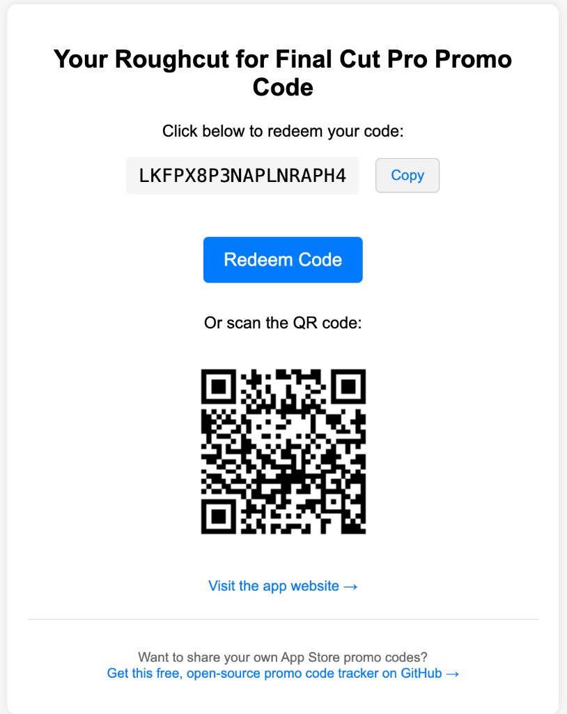

# 🎯 App Store Promo Code Distributor

This script automates the distribution of **Apple App Store promo codes** via **Google Sheets** and **Apps Script**.

## 🎬 Live Demo
Try it yourself: [See it in action](https://script.google.com/macros/s/AKfycbzdYQlSdWy57cJg-aYQ72YF3SK7i_KxWeK4N-_WzxOczGmtdkr5hBJUPSkZS2bZaV23rg/exec)



What you'll see:
- A **Get my promo code** step first (codes are not burned by link previews)
- Then: promo code with Copy, App Store redemption link, and QR code
- If no codes: Redirect to the app website
- A footer linking to this open-source project on GitHub
- Mobile-friendly interface

Note: This is an instance using real codes for my iOS app [Roughcut](https://livup.app/roughcut) for demo purposes.

## 📋 Prerequisites
- Google account
- Apple Developer account with promo codes
- Basic familiarity with Google Sheets
- Your app name and website URL (shown on the redemption page; also used when no codes remain)

## 🚀 Quick Start (Recommended)
1. Open the [template spreadsheet](https://docs.google.com/spreadsheets/d/1tkYNCup-ZtKozkpF6s96E__1DcsUUtso0afIQbF-poE/edit?usp=sharing)
2. Make a copy: **File → Make a copy**
3. Copy and paste your Apple promo codes into column A; leave other columns blank (or set Campaign in column G for pools)
4. Follow the Configuration and Deployment steps below

## ⚙️ Configuration
1. Open the Apps Script editor (**Extensions → Apps Script**)
2. Find the CONFIG object at the top of the script:
   ```javascript
   const CONFIG = {
     EXPIRATION_DAYS: 28,
     APP_NAME: "Your App",
     APP_WEBSITE_URL: "https://yourwebsite.com",
     APP_LOGO_URL: "",
     APP_BLURB: "",
     LOW_STOCK_THRESHOLD: 10,
     MAX_CLAIMS_PER_VISITOR_PER_DAY: 1,
     CLAIM_COOLDOWN_SECONDS: 60,
     MAX_CLAIMS_PER_MINUTE: 30
   };
   ```
3. Set `APP_NAME` to your app’s display name
4. Replace `yourwebsite.com` with your app website URL (homepage link + empty-state redirect)
5. Optionally set `APP_LOGO_URL` and `APP_BLURB` for light branding
6. Tune limits / `LOW_STOCK_THRESHOLD` if needed
7. Save the script

## 🔗 Share URLs (optional query params)
Append tracking and pool params to your web app URL:

- `?src=reddit` — stored in the **Source** column when a code is claimed
- `?campaign=press` — only assigns codes whose **Campaign** column matches (case-insensitive). Omit for the default pool (blank Campaign cells)

Example: `https://script.google.com/macros/s/.../exec?src=twitter&campaign=launch`

## 🔄 Initial Setup
1. In the Apps Script editor:
   - Run the `initialize()` function (sets owner email, sheet headers, and the onEdit trigger)
   - Authorize when prompted
2. Deploy as web app:
   - Click **Deploy → New deployment**
   - Choose "Web app" as type
   - Set "Execute as" to "Me"
   - Set "Who has access" to "Anyone"
   - **Important**: Check "Allow access to anyone, even anonymous"
   - Click Deploy and copy the URL
3. Test deployment:
   - Open URL in an incognito window
   - You should see **Get my promo code** (not an immediate code)
   - If you see "unable to open file" error:
     1. Delete all deployments
     2. Create new deployment
     3. Ensure sheet is shared with anyone (view only)
     4. Try deployment again

Note: The sheet must be accessible to anyone with the link (View only) for the web app to work properly. After pulling script updates, create a **new deployment version**.

## 🌐 Custom Domain (Optional)
Make the app appear to run on your domain:
1. Copy your web app URL after deployment
2. In your domain provider's settings:
   - Create a subdomain (e.g., `codes.yourwebsite.com`)
   - Set up URL forwarding to your web app URL
   - Enable "Forward with masking" or "URL masking" if available
3. Share your custom domain URL instead of the Google Scripts URL

Note: The actual script still runs on Google's servers, but users will see your domain in their browser.

## 📝 Manual Sheet Setup (Alternative)
If not using the template, create a sheet with these headers in row 1:

| Col | Header | Purpose |
| --- | --- | --- |
| A | Promo Code | Code from App Store Connect |
| B | Status | Blank / Available, `Redeemed`, or `Expired` |
| C | Upload Date | Auto-filled |
| D | Expiration Date | Auto-set to upload date + `EXPIRATION_DAYS` |
| E | Redeemed At | Timestamp when claimed |
| F | Source | From `?src=` |
| G | Campaign | Pool name (blank = default pool) |
| H | Visitor Id | Browser visitor id that claimed the row |

Notification flags (all-redeemed / low-stock) are stored in **Script Properties**, not in cell E1.

## 🔐 Security & Permissions
- Script runs under developer's account permissions (intended behavior)
- End users don't need Google account access
- Only the developer needs to authorize the script
- Codes are assigned only on **Get my promo code** (HTTP POST), not on page load or link previews
- Per-browser daily limit, short cooldown, and a global claims/minute cap slow casual draining
- "Execute as Me" setting ensures:
  - Secure sheet access
  - Protected email notifications
  - Controlled code distribution
  - Single point of management

## 🎯 How It Works
1. User opens the web app URL (optionally with `?src=` / `?campaign=`)
2. Landing page asks them to tap **Get my promo code**
3. Script assigns the next available code (with lock + limits), marks it Redeemed, and logs Redeemed At / Source / Visitor Id
4. User can copy the code, open App Store redemption, or scan the QR code
5. Returning with the same browser the same day sees their existing code (no second burn)
6. Developer is emailed when stock is low and again when everything is redeemed/expired

## ✨ Features
- Claim-first reveal (preview-safe)
- Visible promo code with one-tap Copy
- Direct App Store redemption (user-initiated)
- QR code generation (after claim)
- Configurable app name, optional logo + blurb
- Source (`?src=`) and campaign pool (`?campaign=`) tracking
- Per-visitor daily limit, claim cooldown, global rate limit
- 28-day expiration tracking
- Low-stock and all-redeemed email notifications
- App website link + redirect when empty
- GitHub footer on public pages (encourages others to deploy their own copy)

## 📧 Notifications
The script emails the Google account used in `initialize()`:
- When remaining codes drop below `LOW_STOCK_THRESHOLD` (once until you restock above the threshold)
- When all codes are used/expired (once until new available codes appear)
- Subjects: low-stock message / "All Promo Codes Redeemed or Expired"

## ❗ Troubleshooting
Common issues and solutions:
1. Authorization errors:
   - Ensure you're logged into correct Google account
   - Re-run setup functions
   - Check deployment settings
2. Codes not distributing:
   - Verify sheet headers and structure
   - Check date formats
   - Ensure codes aren't marked as used
   - If using `?campaign=`, confirm column G matches
3. Script errors:
   - Check Apps Script logs for error details
   - Verify CONFIG.APP_WEBSITE_URL is properly formatted
   - Ensure all setup steps were completed
4. "Unable to open file" error:
   - Ensure sheet is shared (Anyone with link - Viewer)
   - Create new deployment from scratch
   - Check "Allow access to anyone, even anonymous"
   - Test in incognito window
   - Clear browser cache and try again
5. Link previews / Slack showing empty:
   - Expected — previews do not receive a code; users must open in a browser and tap the button

## 🔄 Maintenance
- Add new codes directly to sheet (column A; optional Campaign in G)
- System auto-updates dates and headers on run
- Low-stock / all-redeemed notify flags reset when inventory recovers
- Script updates preserve Script Properties; redeploy the web app after changes

## 🚀 Benefits
- Preview-safe distribution
- Automatic tracking
- User-friendly interface
- Secure, rate-limited claims

## 🔒 Google Verification
Important: Each developer who deploys this script needs their own verification if they plan to distribute their deployment widely (>100 users).

When you deploy this script from GitHub:
- You create your own instance of the app
- You'll need your own verification if serving >100 users
- The verification process applies to your deployment
- You'll need your own privacy policy and terms

Steps for Your Verification:
1. Prepare Required Documents:
   - Your own Privacy Policy
   - Your own Terms of Service
   - Your application homepage
   - Demo video of your deployment

2. Update Script Properties:
   - Add app name in script properties
   - Add support email
   - Add links to policy documents

3. Submit for Verification:
   1. In Apps Script editor: **Deploy → New deployment**
   2. Click "Configure OAuth" (under "Web app")
   3. Fill in Application Details:
      - Application name
      - Support email
      - Developer email
      - Links to privacy policy & terms
   4. Click "Configure Consent Screen"
   5. Complete OAuth Consent Screen in Google Cloud Console
   6. Submit for verification

Required OAuth Scopes Explanation:
- `https://www.googleapis.com/auth/spreadsheets`: Manage promo codes
- `https://www.googleapis.com/auth/script.scriptapp`: Create triggers
- `https://www.googleapis.com/auth/script.send_mail`: Send notifications

Note: For internal use or <100 users, verification is not required for your deployment, but users will see an "unverified app" warning.

## 👩‍💻 Development & Sync
Keep the template and GitHub version in sync using clasp:

1. Install clasp:
   ```bash
   npm install -g @google/clasp
   ```

2. Login to Google:
   ```bash
   clasp login
   ```

3. Clone the template script:
   ```bash
   clasp clone "1tkYNCup-ZtKozkpF6s96E__1DcsUUtso0afIQbF-poE" --rootDir ./src
   ```

4. Push updates:
   ```bash
   clasp push
   ```

5. Pull changes:
   ```bash
   clasp pull
   ```

Note: You'll need to enable the Google Apps Script API in your Google Cloud Console.

For template maintainers:
1. Make changes locally
2. Test changes
3. Push to both GitHub and template:
   ```bash
   git push origin main
   clasp push
   ```

This ensures both versions stay synchronized.
